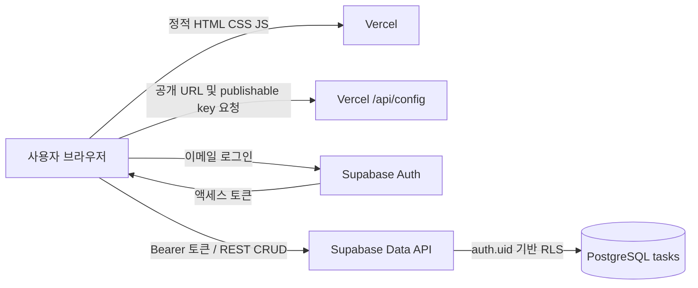

# 모아 칸반보드 아키텍처

## 1. 변경 범위
기존 단일 HTML의 디자인, 검색, 우선순위 필터, 통계, 카드 편집, 드래그 이동, JSON 백업 기능을 유지하면서 HTML/CSS/JavaScript를 분리했다. 카드 원본은 Supabase PostgreSQL에 저장한다. localStorage, sessionStorage, IndexedDB에는 카드 또는 로그인 토큰을 저장하지 않는다. 화면 표시를 위한 카드 배열과 로그인 세션만 메모리에 존재한다.

실제 Vercel 프로젝트와 Supabase에 접속하여 배포하거나 테이블을 생성한 상태는 아니다. 아래 설정을 적용해야 동작한다.

## 2. 파일 구조
```text
index.html          화면 및 로그인/편집 폼
styles.css          기존 반응형 디자인과 추가 로그인 스타일
app.js              DOM 렌더링, 인증, 카드 CRUD, 백업
api/config.js       Vercel 환경변수에서 공개 연결 설정 반환
supabase.sql        테이블, 인덱스, RLS, 트리거, 백업 교체 함수
vercel.json         기본 보안 헤더
package.json        프로젝트 메타데이터 (외부 의존성 없음)
.env.example        환경변수 이름 예시
아키텍처.md         구성 및 설치·검증 절차
```

## 3. 데이터 흐름


Vercel API는 카드 데이터를 대신 저장하지 않는다. 공개 설정만 제공하며 브라우저는 Supabase의 공식 REST/Auth API를 직접 사용한다. 공개 키가 보이는 것은 정상이며 데이터 보안은 인증과 RLS로 보장한다. `service_role` 또는 `sb_secret_` 키를 절대 넣지 않는다. 기존 anon JWT를 쓰는 경우에도 role이 anon인 키만 허용한다.

## 4. 데이터 모델과 접근 제어
- `id`: UUID, 서버 생성.
- `user_id`: Supabase Auth 사용자 ID. 계정 삭제 시 해당 카드도 삭제.
- `title`: 공백 제외 1~150자, `description`: 최대 5,000자.
- `status`: todo / doing / done, `priority`: low / medium / high.
- `due`: 날짜 또는 NULL.
- `created_at`, `updated_at`: 서버 시간. 수정 시 트리거가 updated_at 갱신.

모든 작업은 authenticated 역할에만 허용되며, 각 행의 user_id가 현재 로그인 사용자와 같아야 한다. 익명 사용자는 조회/생성/수정/삭제할 수 없다. 공개 공유 보드가 아니라 **사용자별 개인 보드**다.

## 5. 저장·동시성·동기화
- 생성: POST /rest/v1/tasks → 반환된 서버 행을 화면에 반영.
- 수정/상태 이동: PATCH → 서버 성공 후 화면 갱신.
- 삭제: DELETE → 삭제된 행 확인 후 화면에서 제거.
- 수정과 삭제는 id + 마지막 updated_at을 조건으로 사용한다. 다른 창에서 이미 수정된 경우 덮어쓰지 않고 새로고침을 안내한다.
- 중복 클릭은 busy 상태로 억제한다. 저장 실패 시 편집창을 유지하고 오류를 표시한다. 네트워크 단절 직후에는 서버에 저장되었지만 응답만 잃었을 가능성도 있으므로 새로고침으로 확인한다.
- 별도 실시간 구독은 없으며 다른 기기의 변경은 ‘새로고침’ 버튼 또는 재로그인 시 조회한다.
- 열 내부 순서는 최근 수정 시각 내림차순이다. 열 안에서 임의 순서를 지정하는 기능은 없다.
- 조회는 1,000행 단위로 페이지 처리하며 최대 10,000개를 지원한다. 대규모 보드에서는 서버 검색·페이지 UI로 확장한다.
- 토큰은 요청 전 필요하면 갱신한다. 브라우저 새로고침 시 다시 로그인한다. 카드와 토큰을 브라우저 영구 저장소에 보관하지 않기 위한 의도적인 선택이다.
- 비밀번호는 Supabase Auth에 HTTPS로 전달하며 앱 데이터베이스나 로그에 저장하지 않는다. 브라우저 자체의 비밀번호 관리자 기능은 별개다.

## 6. 백업과 기존 데이터 이전
기존 모아의 version:1 JSON 백업을 읽을 수 있다. 복원 시 과거 ID는 새 UUID로 바뀐다. 현재 로그인 계정의 카드 전체를 교체하며 다른 계정은 영향받지 않는다.

`replace_my_tasks`는 SECURITY INVOKER 및 RLS 아래 삭제/삽입을 한 트랜잭션에서 수행한다. 삽입 검증이 실패하면 삭제도 롤백된다. 백업 복원끼리는 사용자별 잠금을 적용하지만 일반 CRUD까지 모두 잠그지는 않으므로 복원 중 다른 창의 편집을 중단해야 한다.

기존 브라우저 데이터는 새 앱에서 자동 접근하지 않는다. **기존 배포본에서 먼저 ‘백업 내보내기’ → 새 앱 배포 → 로그인 → ‘백업 불러오기’** 순서로 이전한다. 이미 기존 페이지를 교체했다면, 기존 파일을 같은 원래 도메인에 잠시 복구하여 백업을 내보내야 한다. 다른 도메인에서는 기존 브라우저 저장소를 읽을 수 없다.

## 7. Supabase 설치
1. Supabase 프로젝트를 생성하거나 사용할 프로젝트를 연다.
2. SQL Editor에서 `supabase.sql` 전체를 한 번 실행한다. 새 `public.tasks` 테이블을 만드는 초기 설치용이다. 같은 이름의 테이블이 이미 있다면 무작정 실행하거나 삭제하지 말고 별도 마이그레이션을 작성한다.
3. Authentication에서 Email/Password를 활성화하고 이메일 확인 정책을 선택한다. 회원가입 후 확인 메일을 요구하면 확인 후 앱에서 로그인한다.
4. Authentication의 Site URL을 실제 Vercel 배포 주소 또는 사용자 도메인으로 설정한다. 이메일 확인 후 돌아올 주소도 해당 도메인으로 설정한다.
5. 프로젝트 URL과 publishable key를 확인한다. 공개 anon 키도 지원하나 서버 비밀 키는 사용하지 않는다.

## 8. Vercel 배포
1. 이 폴더의 내용을 기존 Git 저장소의 Vercel Root Directory 위치에 반영한다. 기존 HTML은 이전을 위해 별도 보관한다.
2. 프레임워크는 **Other**, 별도 Build Command 없음, Output Directory는 프로젝트 루트의 기본 정적 제공 설정을 사용한다. API 폴더를 제외한 다른 출력 폴더를 지정하지 않는다.
3. Environment Variables에 아래 값을 추가한다.
   - `SUPABASE_URL`: `https://사용할-프로젝트.supabase.co`
   - `SUPABASE_PUBLISHABLE_KEY`: 해당 프로젝트의 공개 publishable key
4. Production과 사용하는 Preview 환경에 각각 설정한다. `.env.example`은 참고용이며 Vercel 환경변수를 자동 등록하지 않는다.
5. 배포한다. 환경변수를 바꿨다면 재배포한다.
6. 기존 Rewrite가 모든 요청을 index.html로 보내는 경우 `/api/config`가 API 함수로 처리되도록 수정한다.

HTML 파일을 더블클릭해서 여는 방식은 지원하지 않는다. `/api/config`는 Vercel 함수이므로 Vercel 배포 환경에서 동작한다. 외부 JavaScript CDN이나 프런트엔드 라이브러리가 필요하지 않다.

## 9. 적용 후 점검
- 설정 누락 시 연결 오류가 표시되고 카드 작성이 비활성화되는지 확인.
- 회원가입, 이메일 확인, 로그인 후 카드 생성/수정/드래그 이동/삭제를 수행.
- Supabase Table Editor에서 실제 행 변경을 확인.
- 같은 계정으로 다른 브라우저에서 로그인하고 새로고침해 동일 데이터를 확인.
- 다른 계정에서는 이전 계정의 카드가 보이지 않고 수정할 수 없는지 확인.
- 네트워크 단절 시 성공 메시지가 나오지 않고 편집 입력이 유지되는지 확인.
- 같은 카드를 두 창에서 수정해 뒤늦은 수정이 충돌 안내로 차단되는지 확인.
- 기존 백업 복원 후 카드 수/제목/상태/마감일을 비교.

## 10. 검증 범위와 한계
제공 파일의 JavaScript 문법, HTML의 참조 파일 및 요소 연결, 브라우저 저장 API 제거 여부를 정적으로 점검했다. 실제 계정 정보와 배포 권한이 제공되지 않았으므로 Supabase SQL 실행, 인증 메일, 실제 CRUD, 브라우저 렌더링 및 Vercel 운영 배포 테스트는 수행하지 않았다. 백업 JSON 다운로드는 사용자가 직접 요청하는 파일 내보내기이며 앱의 브라우저 내부 자동 저장과는 다르다.
